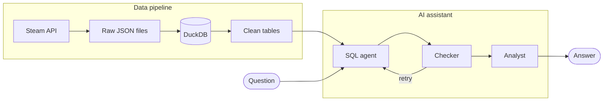

# Steam Data Pipeline

Pipeline that collects the number of players and the updates of 10 Steam games several times a day.

Goal: find out whether game updates bring players back.

## Pipeline



## Steps

1. `collect.py`: fetches data from the Steam API and saves it as JSON
2. `load.py`: loads the JSON files into DuckDB
3. `steam_dbt/`: cleans the data and builds a summary table per game
4. GitHub Actions: runs everything automatically on a schedule (about 5 times a day)

An Airflow DAG (`dags/`) can also run the pipeline locally with Docker.

## AI assistant

A web app (`app.py`, built with Streamlit) answers questions about the data in plain language.
Three agents work together (`agents.py`):

1. the SQL agent writes a query on the DuckDB database
2. the checker validates the result, and sends the query back for correction if needed (3 attempts max)
3. the analyst writes the answer

Queries run on a read-only database, with no file access, and only `select` queries are allowed.

Note: the assistant runs on the free tier of the Gemini API. If the daily quota is reached,
it may be unavailable until the next day. Each visitor can ask up to 10 questions, and an answer
usually takes 10 to 30 seconds, since three agents work on each question.

## Stack

Python, DuckDB, SQL, dbt, GitHub Actions, Airflow, Docker, LangChain, Gemini, Streamlit

## Run the project

```bash
pip install -r requirements.txt
python collect.py players
python collect.py news
python load.py
dbt build --project-dir steam_dbt --profiles-dir steam_dbt
```

With Airflow:

```bash
docker compose up --build
```

Then open http://localhost:8080

Run the assistant (needs a Gemini API key in `.streamlit/secrets.toml`):

```bash
streamlit run app.py
```

**Try the AI assistant:** https://steam-assistant.streamlit.app 
(may be unavailable if the free daily API quota has been reached)
